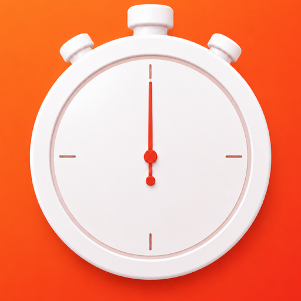

<p align="left">
    
</p>

[](https://swift.org)
[](https://developer.apple.com/ios/)
[](https://developer.apple.com/xcode/)
[](LICENSE)

# Repeating Timer

A tiny productivity app for MacOS, which runs a timer in a loop, eg. fires every 15 minutes.

The purpose is to be aware of a time running by, while being focused on something.

## Features

- Preset intervals: 15 minutes, 30 minutes, 1 hour, plus a custom value in minutes;
- Countdown is derived from an end date, so it stays correct after the Mac wakes from sleep;
- Last interval selection is persisted across launches;
- Foreground alert pop-up window when each interval completes (at most one alert window on screen at any time, easily dismissed with `Enter` or `Esc`);
- Closing the last window quits the app and dismisses any open alert;

## Images & Recordings

https://github.com/user-attachments/assets/44c13720-f917-4a9a-8407-d3d4fdafc9f7


## Requirements

- macOS 26.5+
- Xcode 26

## Build

Open `RepeatingTimer.xcodeproj` and run the **RepeatingTimer** scheme.

```sh
xcodebuild -scheme RepeatingTimer -destination 'platform=macOS' build
```

## Tests

`TimerViewModel` is covered with Swift Testing. `ReminderPresenting` is injected so tests never show real alert windows.

```sh
xcodebuild -scheme RepeatingTimer -destination 'platform=macOS' test
```

## Alert Pop-up

When a cycle completes, Repeating Timer presents a floating `NSPanel` that joins the active Space (including over full-screen apps) and takes keyboard focus so it can be dismissed immediately with `Enter` or `Esc`.

A single panel instance is reused across cycles: if the Mac is left unattended for multiple intervals, the existing alert stays on screen rather than stacking multiple windows.

## Project structure

```
RepeatingTimer/                  App target
  RepeatingTimerApp.swift        Entry point and app delegate
  ContentView.swift              Interval picker and countdown UI
  TimerViewModel.swift           Timer state, persistence, cycle rollover
  ReminderAlertPresenter.swift   Foreground alert panel presentation
  IntervalOption.swift           Preset and custom intervals
RepeatingTimerTests/             Unit tests
RepeatingTimer.xcodeproj
```

## License

MIT — see [LICENSE](LICENSE).
