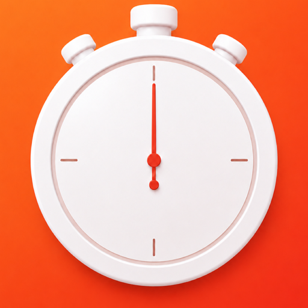

# Repeating Timer

<p align="left">
    
</p>

[](https://swift.org)
[](https://developer.apple.com/ios/)
[](https://developer.apple.com/xcode/)
[](LICENSE)

A tiny productivity app for MacOS, which runs a timer in a loop, eg. fires every 15 minutes.

The purpose is to be aware of a time running by, while being focused on something.

## Features

- Preset intervals: 15 minutes, 30 minutes, 1 hour, plus a custom value in minutes;
- Countdown is derived from an end date, so it stays correct after the Mac wakes from sleep;
- Last interval selection is persisted across launches;
- Notification permission is requested when the timer starts, not on first launch;
- If permission is denied, the UI links straight to System Settings;
- Closing the last window quits the app and cancels any pending reminder;

## Images & Recordings

https://github.com/user-attachments/assets/44c13720-f917-4a9a-8407-d3d4fdafc9f7


## Requirements

- macOS 26.5+
- Xcode 26

## Build

Open `RepeatingTimer.xcodeproj` and run the **RepeatingTimer** scheme.

```sh
xcodebuild -scheme RepeatingTimer -destination 'platform=macOS' build
```

## Tests

`TimerViewModel` is covered with Swift Testing. `ReminderScheduling` is injected so tests never touch `UNUserNotificationCenter`.

```sh
xcodebuild -scheme RepeatingTimer -destination 'platform=macOS' test
```

## Notifications

A repeating `UNTimeIntervalNotificationTrigger` that reuses one request identifier is not reliable here. If the previous banner is still on screen, Notification Center coalesces the next delivery into an in-place update — no banner, no sound.

Repeating Timer schedules a one-shot request with a fresh identifier on each cycle instead. The previous request is left alone at rollover so cancelling it cannot swallow the banner that just fired.

## Project structure

```
RepeatingTimer/            App target
  RepeatingTimerApp.swift  Entry point and app delegate
  ContentView.swift        Interval picker, countdown, permission UI
  TimerViewModel.swift     Timer state, persistence, scheduling
  NotificationManager.swift Local notifications
  IntervalOption.swift     Preset and custom intervals
RepeatingTimerTests/       Unit tests
RepeatingTimer.xcodeproj
```

## License

MIT — see [LICENSE](LICENSE).
